<header class="academic-header" markdown="1">
<h1 class="academic-title">A new Ginga Developer Ecosystem with ginga.org.br portal, ginga-playground and ginga-code tools</h1>
<div class="academic-authors">
<div class="academic-author">
<div class="author-name">Alan L. V. Guedes</div>
<div class="author-inst">University of Reading</div>
</div>
<div class="academic-author">
<div class="author-name">Paulo Victor Borges</div>
<div class="author-inst">PUC-Rio</div>
</div>
<div class="academic-author">
<div class="author-name">Daniel Moraes</div>
<div class="author-inst">PUC-Rio</div>
</div>
<div class="academic-author">
<div class="author-name">Sergio Colcher</div>
<div class="author-inst">PUC-Rio</div>
</div>
</div>
<div class="academic-conference">WTVDI 2026</div>
<div class="academic-links" markdown="span">
<a class="academic-link-btn" href="https://doi.org/10.5753/webmedia_estendido.2026.34168">
:simple-doi: <span>DOI</span>
</a>
<a class="academic-link-btn" href="assets/pdfs/main.pdf">
:lucide-download: <span>Pre-print</span>
</a>
<a class="academic-link-btn" href="slides/">
:lucide-presentation: <span>Slides</span>
</a>
<a class="academic-link-btn" href="https://github.com/alanlivio/gingaf">
:simple-github: <span>Code Repo</span>
</a>
<a class="academic-link-btn" href="https://github.com/alanlivio/paper-gingaf-ecosystem">
:simple-github: <span>Paper Repo</span>
</a>
</div>
</header>

<div class="abstract-container" markdown="1">
<div class="abstract-inner" markdown="1">

## Abstract

Interactive development and debugging of Nested Context Language (NCL) applications remain challenging due to the traditional decoupling between document authoring tools and runtime execution engines. In this paper, we present the new **Ginga Developer Ecosystem**, a unified suite combining the official portal **`ginga.org.br`**, the web-native **`ginga-playground`** (powered by Monaco Editor, debounced compilation, and CanvasKit WebAssembly graphics), and **`ginga-vscode`** (a Visual Studio Code extension providing WebSocket Debug Bridge integration, deterministic Virtual Clock time-stepping, live sourcemapped link highlighting, and reactive property inspection).

</div>
</div>

## Ecosystem Pillars

1. **`ginga.org.br` Official Portal**: Interactive tutorial embedding, deep-linking parameter passing (`?ncl=`, `?code=`), and portal-wide documentation integration.
2. **`ginga-playground` Workbench**: In-browser live authoring environment running `ncl_doc` compiled to WebAssembly with 60 FPS CanvasKit GPU rendering.
3. **`ginga-vscode` Extension**: Full IDE development workflow featuring Webview player tabs, WebSocket Debug Bridge, and sub-millisecond Virtual Clock control.

## Selected Applications

<table>
  <tbody>
    <tr>
      <td align="center" width="50%">
        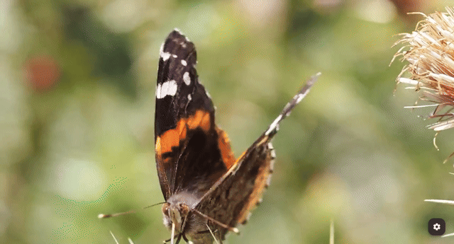<br />
        NCL with basic links (<a href="https://ginga.org.br/gingaf/playground/?app=video.ncl">video.ncl</a>)
      </td>
      <td align="center" width="50%">
        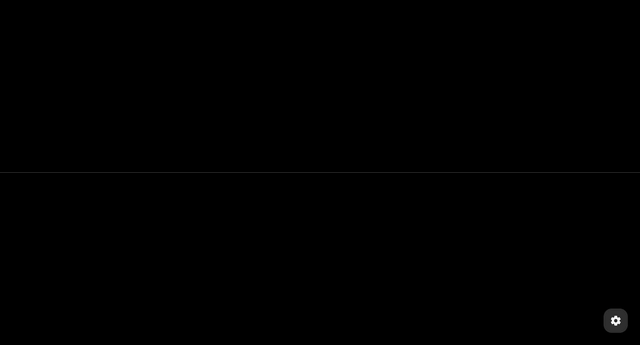<br />
        NCL with videos grid (<a href="https://ginga.org.br/gingaf/playground/?app=video_grid.ncl">video_grid.ncl</a>)
      </td>
    </tr>
    <tr>
      <td align="center" width="50%">
        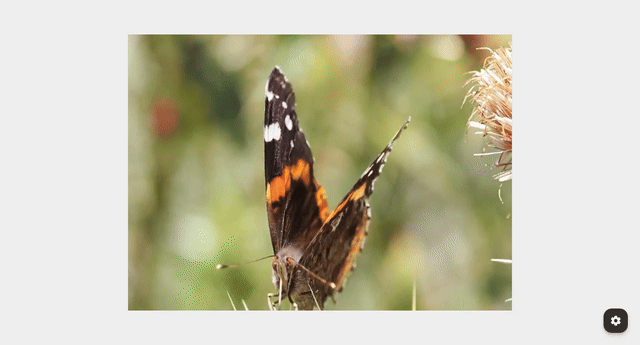<br />
        NCL embedded with NCL (<a href="https://ginga.org.br/gingaf/playground/?app=emb_ncl.ncl">emb_ncl.ncl</a>)
      </td>
      <td align="center" width="50%">
        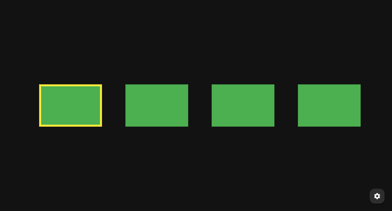<br />
        NCL with focus navigation and selection (<a href="https://ginga.org.br/gingaf/playground/?app=focus_nav.ncl">focus_nav.ncl</a>)
      </td>
    </tr>
    <tr>
      <td align="center" width="50%">
        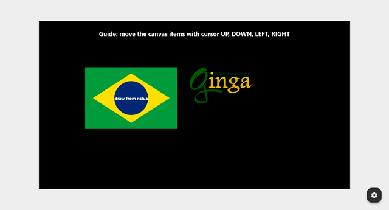<br />
        NCL with lua canvas drawing and keys (<a href="https://ginga.org.br/gingaf/playground/?app=lua_canvas.ncl">lua_canvas.ncl</a>)
      </td>
      <td align="center" width="50%">
        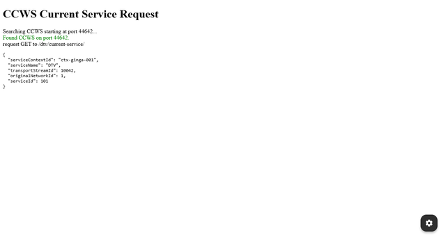<br />
        HTML with CCWS /current-service/ (<a href="https://ginga.org.br/gingaf/playground/?app=current_service.html">current_service.html</a>)
      </td>
    </tr>
    <tr>
      <td align="center" width="50%">
        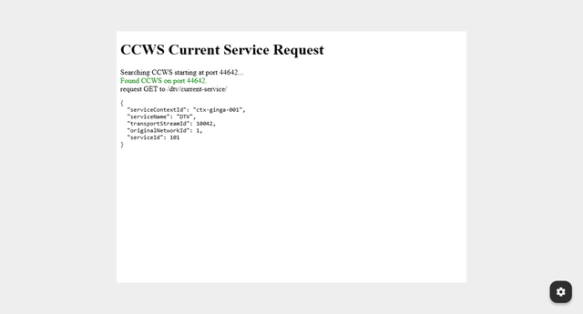<br />
        NCL with embedded HTML document (<a href="https://ginga.org.br/gingaf/playground/?app=emb_html.ncl">emb_html.ncl</a>)
      </td>
      <td align="center" width="50%">
        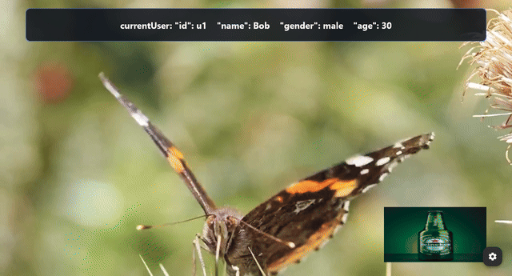<br />
        NCL with multi-user profile switching and targeted advertising (<a href="https://ginga.org.br/gingaf/playground/?app=multiuser_profile/main.ncl">multiuser_profile/main.ncl</a>)
      </td>
    </tr>
  </tbody>
</table>

## Multi-platform Demos

<table>
  <tbody>
    <tr>
      <td align="center" width="50%">
        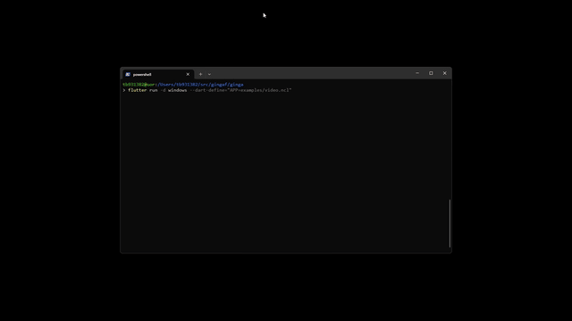<br />
        Windows
      </td>
      <td align="center" width="50%">
        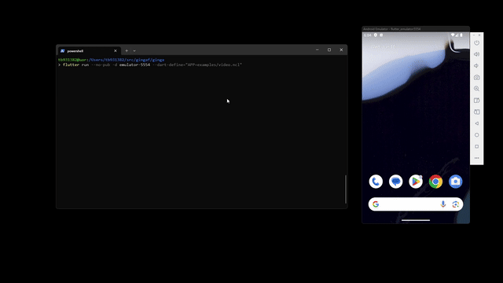<br />
        Android
      </td>
    </tr>
    <tr>
      <td align="center" width="50%">
        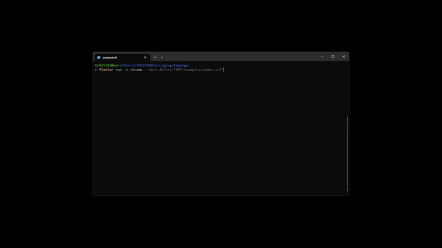<br />
        Chrome
      </td>
      <td align="center" width="50%">
        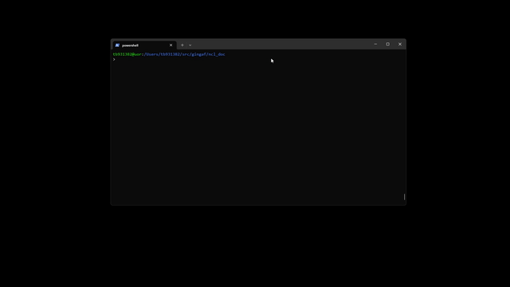<br />
        CLI (headless execution)
      </td>
    </tr>
  </tbody>
</table>

## Citation

```bibtex
@inproceedings{ginga_ecosystem2026,
  author    = {Guedes, Alan L. V. and Borges, Paulo Victor and Moraes, Daniel and Colcher, Sergio},
  title     = {A new Ginga Developer Ecosystem with ginga.org.br portal, ginga-playground and ginga-code tools},
  booktitle = {Anais Estendidos do XXXII Simpósio Brasileiro de Sistemas Multimídia e Web (WTVDI 2026)},
  location  = {Lavras, Brazil},
  year      = {2026},
  pages     = {233--235},
  publisher = {SBC},
  address   = {Porto Alegre, RS, Brasil},
  doi       = {10.5753/webmedia_estendido.2026.34168},
  url       = {https://doi.org/10.5753/webmedia_estendido.2026.34168}
}
```

<footer class="academic-footer md-typeset">
<p>Built with <a href="https://zensical.org" rel="nofollow">Zensical</a> based on <a href="https://research-template.roman.technology" rel="nofollow">Roman Hauksson-Neill's project page template</a></p>
</footer>
