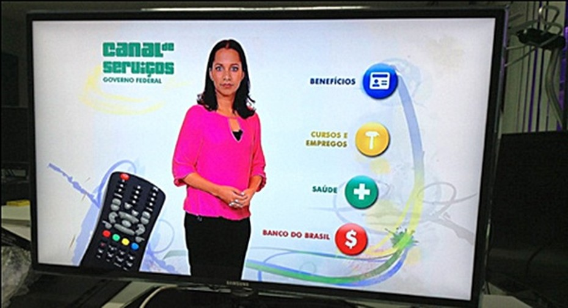
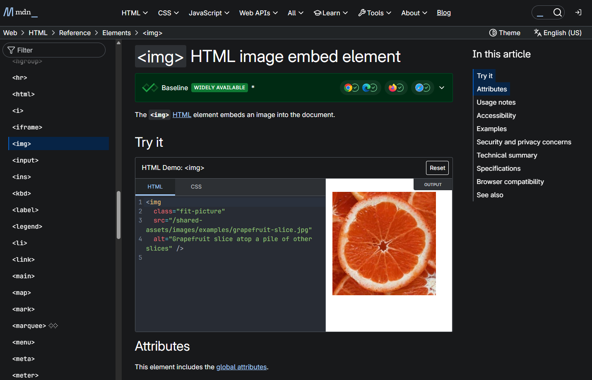
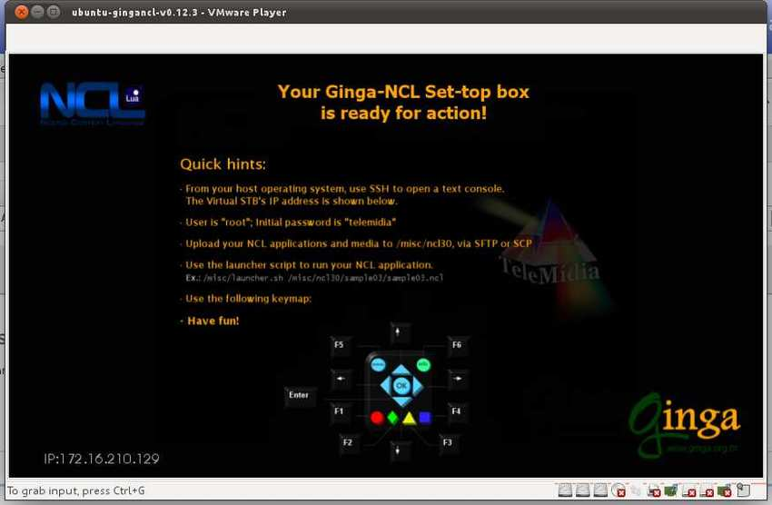
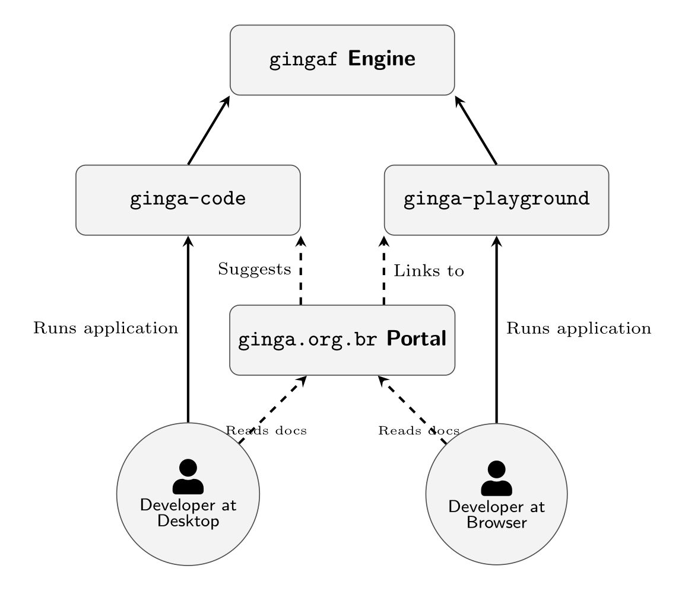
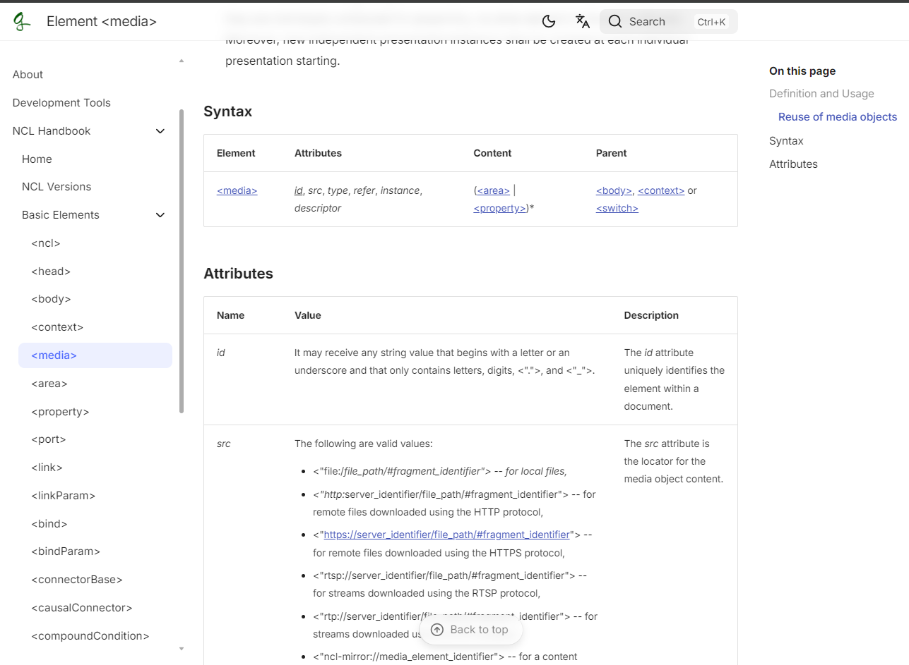
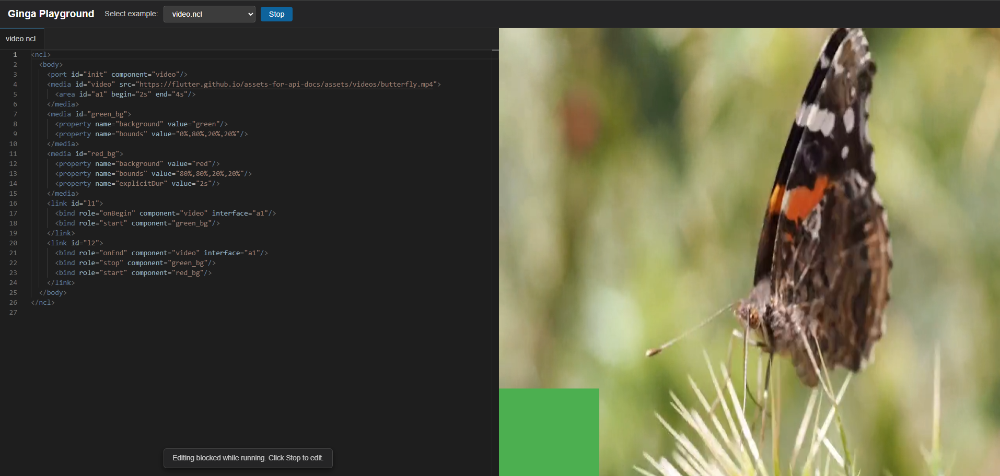

<!--
_paginate: false
_header: ""
-->

# A New Ginga Developer Ecosystem: ginga.org.br Portal, ginga-playground and ginga-code Tools

**Alan L. V. Guedes**$^1$, **Paulo Victor Borges**$^2$, **Daniel Moraes**$^2$, **Sergio Colcher**$^2$
$^1$University of Reading, UK | $^2$PUC-Rio, BR

*XXXII Simpósio Brasileiro de Sistemas Multimídia e Web (WebMedia 2026)*

**Website do Artigo (slides, código, demo)**:
https://alanlivio.github.io/paper-webmedia26-ecosystem/

---

# Agenda

- **Contexto e Definição do Problema**
- **Solução Proposta**
- **Considerações Finais**

---

<!-- _class: invert -->
<!-- _paginate: skip -->

# Contexto e Definição do Problema

---

# O Middleware de DTV Ginga

  

    

      
    

    

      
    

  

  

    

      
    

    

      
    

  

Definido na série de normas SBTVD ABNT 15606.

Presente em receptores de TV Digital certificados no Brasil e América Latina (>60M telespectadores)

---

# Ecossistema de Desenvolvimento Ginga é limitado

**Ausência de ambiente portátil e "zero-install"**: de fácil acesso, completo e aberto.
- Podemos comparar o Mozilla https://developer.mozilla.org/ e a Ginga-VM (2010)

  
  

---

<!-- _class: invert -->
<!-- _paginate: skip -->

# Solução Proposta

---

# Os Quatro Pilares do Ecossistema

**Pilar 1: Motor de Execução `gingaf`**
- Ambiente desacoplado e multiplataforma para execução de aplicações NCL e HTML5.

**Pilar 2: Portal Web `ginga.org.br`**
- Centro unificado de conhecimento, manual do NCL, tutoriais e referências aos padrões técnicos.

**Pilar 3: Ambiente Interativo `ginga-playground`**
- Ambiente web interativo para editar e executar aplicações NCL e HTML5 instantaneamente no navegador.

**Pilar 4: Extensão para VS Code `ginga-code`**
- Integração com IDE oferecendo destaque de sintaxe, execução de aplicações e ponte de depuração em tempo real.

---

# Arquitetura do Ecossistema

**Núcleo Unificado**
- Todos os quatro pilares convergem na arquitetura desacoplada do motor `gingaf`.
- Semântica compartilhada de análise sintática e execução em fluxos de trabalho desktop e web.

**Sinergia de Fluxo de Trabalho**
- Desenvolvedores aprendem conceitos em `ginga.org.br`.
- Prototipam e compartilham exemplos mínimos reproduzíveis através do `ginga-playground`.
- Constroem aplicações prontas para produção no Visual Studio Code com o `ginga-code`.

---

<!-- _class: invert -->
<!-- _paginate: skip -->

# Pilar 1: gingaf

---

# Pilar 1: gingaf

## NCL com Links, Grade de Vídeos, NCL Embutido e Navegação

  

    
    
NCL com links básicos (<a href="https://ginga.org.br/gingaf/playground/?app=video.ncl">video.ncl</a>)

  

  

    
    
NCL com grade de vídeos (<a href="https://ginga.org.br/gingaf/playground/?app=video_grid.ncl">video_grid.ncl</a>)

  

  

    
    
NCL embutido em NCL (<a href="https://ginga.org.br/gingaf/playground/?app=emb_ncl.ncl">emb_ncl.ncl</a>)

  

  

    
    
NCL com navegação de foco e seleção (<a href="https://ginga.org.br/gingaf/playground/?app=focus_nav.ncl">focus_nav.ncl</a>)

  

---

# Pilar 1: gingaf

## NCLua, HTML+CCWS, HTML Embutido e Multiusuário

  

    
    
NCL com desenho em tela Lua e teclas (<a href="https://ginga.org.br/gingaf/playground/?app=lua_canvas.ncl">lua_canvas.ncl</a>)

  

  

    
    
HTML com CCWS /current-service/ (<a href="https://ginga.org.br/gingaf/playground/?app=current_service.html">current_service.html</a>)

  

  

    
    
NCL com documento HTML embutido (<a href="https://ginga.org.br/gingaf/playground/?app=emb_html.ncl">emb_html.ncl</a>)

  

  

    
    
NCL com troca de perfil multiusuário e publicidade direcionada (<a href="https://ginga.org.br/gingaf/playground/?app=multiuser_profile/main.ncl">multiuser_profile/main.ncl</a>)

  

---

<!-- _class: invert -->
<!-- _paginate: skip -->

# Pilar 2: Portal Web ginga.org.br

---

# Pilar 2: Portal Web ginga.org.br

**Arquitetura Moderna**
- Construído com gerador de sites estáticos moderno (Zensical).
- Documentação multilíngue: português, espanhol e inglês.

**Recursos Hospedados**
- Guias introdutórios para novos desenvolvedores Ginga.
- Manual abrangente de tags e atributos do NCL.
- Especificações oficiais do SBTVD e da ITU-T.
- Exemplos selecionados e trechos interativos de código.

---

<!-- _class: invert -->
<!-- _paginate: skip -->

# Pilar 3: Ambiente Interativo ginga-playground

---

# Pilar 3: Ambiente Interativo ginga-playground

**Execução Web Sem Instalação**
- Executa diretamente em qualquer navegador moderno usando WebAssembly / CanvasKit.
- Impulsionado pelo motor desacoplado `gingaf`.

**Capacidades Interativas**
- Layout dividido: editor de código à esquerda, pré-visualização ao vivo da TV à direita.
- Catálogo interativo pré-carregado com aplicações de exemplo em NCL, Lua e HTML5.
- Renderização instantânea após edições de código, sem recarregar a página.
- Controle remoto virtual para simular o pressionamento de teclas da DTV.

---

<!-- _class: invert -->
<!-- _paginate: skip -->

# Pilar 4: Extensão para VS Code ginga-code

---

# Pilar 4: Extensão para VS Code ginga-code

**Disponibilidade Oficial no Marketplace**
- Publicada diretamente no Visual Studio Code Marketplace e Open VSX.

**Fluxos de Trabalho Modernos**
- Reconhecimento de sintaxe e validação de esquemas XML e NCL.
- Execução com um clique para pré-visualizar aplicações localmente ou no navegador.
- Ponte de depuração conectando breakpoints da IDE aos estados de execução do `gingaf`.
- Geração de templates para prototipagem rápida de aplicações de TV 2.5 e TV 3.0.

---

<!-- _class: invert -->
<!-- _paginate: skip -->

# Considerações Finais

---

# Considerações Finais

**Contribuições Principais**:
- **Portal `ginga.org.br`**: Hub unificado de documentação e especificações para a comunidade Ginga.
- **`ginga-playground`**: Workbench web interativo no navegador para prototipação sem instalação local.
- **`ginga-code`**: Extensão para VS Code que integra launcher e execução direta no desktop.

**Impacto**: Elimina o atrito inicial de configuração e viabiliza acesso imediato a estudantes, pesquisadores e desenvolvedores (código aberto em `https://ginga.org.br`).

---

<!--
_paginate: false
_header: ""
-->

# Obrigado!

### Dúvidas e Discussão

- **Portal**: https://ginga.org.br
- **Playground**: https://ginga.org.br/gingaf/playground/
- **Extensão VS Code**: https://marketplace.visualstudio.com/items?itemName=ginga-org-br.ginga-code
- **Repositório**: https://github.com/ginga-org-br
- **Contato**: `a.guedes@reading.ac.uk` | `danielmoraes@telemidia.puc-rio.br`

