<!--
_paginate: false
_header: ""
_class: cols-3-1 vcenter
-->

- # A New Ginga Developer Ecosystem: ginga.org.br Portal, ginga-playground and ginga-code Tools

  **Alan L. V. Guedes**$^1$, **Paulo Victor Borges**$^2$, **Daniel Moraes**$^2$, **Sergio Colcher**$^2$
  $^1$University of Reading, UK | $^2$PUC-Rio, BR

  *XXXII Simpósio Brasileiro de Sistemas Multimídia e Web (WebMedia 2026)*

  **Website do Artigo (slides, código, demo)**:
  https://alanlivio.github.io/paper-webmedia26-ecosystem/

- 

  

  

---

# Agenda

- **Contexto e Definição do Problema**
- **Solução Proposta**
- **Considerações Finais**

---

<!-- _class: invert -->
<!-- _paginate: skip -->

# Contexto e Definição do Problema

---

<!-- _class: grid-2x2 center -->

# O Middleware de DTV Ginga

- 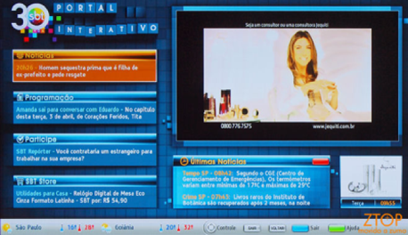

- 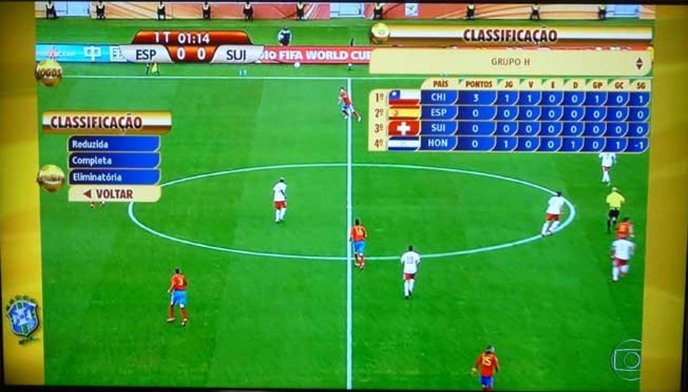

- 

- 

Definido na série de normas SBTVD ABNT 15606. Presente em receptores de TV Digital certificados no Brasil e América Latina (>60M telespectadores).

---

<!-- _class: cols-2 vcenter -->

# Ecossistema de Desenvolvimento Ginga é limitado

**Ausência de ambiente portátil e "zero-install"**: de fácil acesso, completo e aberto.
Podemos comparar o Mozilla (https://developer.mozilla.org/) e a Ginga-VM (2010)

- 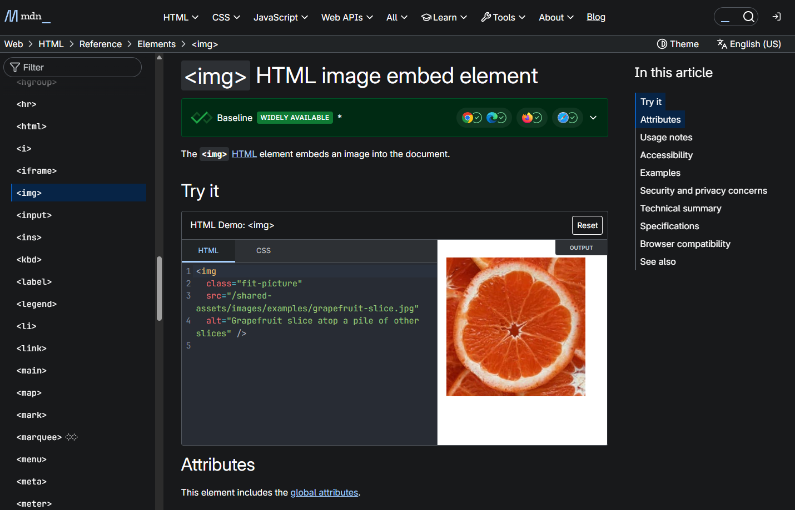

- 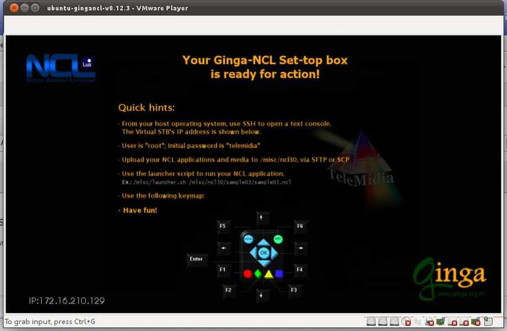

---

<!-- _class: invert -->
<!-- _paginate: skip -->

# Solução Proposta

---

<!-- _class: grid-2x2 -->

# Os Quatro Pilares do Ecossistema

- **Pilar 1: Motor de Execução `gingaf`**
  Ambiente desacoplado e multiplataforma para execução de aplicações NCL e HTML5.

- **Pilar 2: Portal Web `ginga.org.br`**
  Centro unificado de conhecimento, manual do NCL, tutoriais e referências aos padrões técnicos.

- **Pilar 3: Ambiente Interativo `ginga-playground`**
  Ambiente web interativo para editar e executar aplicações NCL e HTML5 instantaneamente no navegador.

- **Pilar 4: Extensão para VS Code `ginga-code`**
  Integração com IDE oferecendo destaque de sintaxe, execução de aplicações e ponte de depuração em tempo real.

---

<!-- _class: cols-3-1 vcenter -->

# Arquitetura do Ecossistema

- **Núcleo Unificado**
  Todos os quatro pilares convergem na arquitetura desacoplada do motor `gingaf`, com semântica compartilhada de análise sintática e execução em fluxos de trabalho desktop e web.

  **Sinergia de Fluxo de Trabalho**
  Desenvolvedores aprendem conceitos em `ginga.org.br`, prototipam e compartilham exemplos mínimos reproduzíveis através do `ginga-playground`, e constroem aplicações prontas para produção no Visual Studio Code com o `ginga-code`.

- 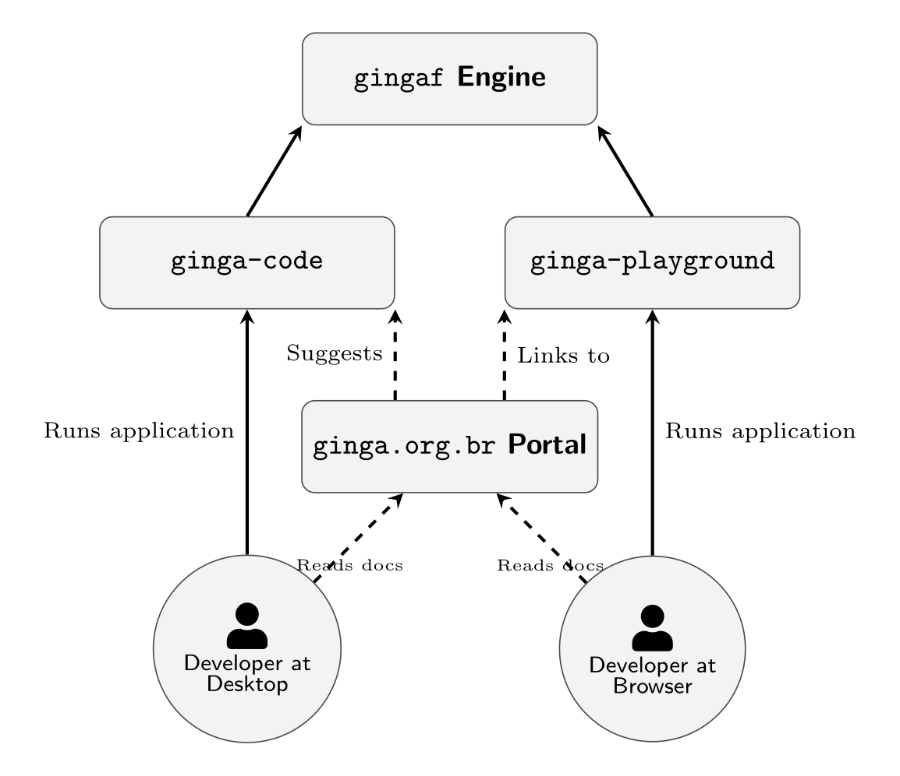

---

<!-- _class: invert -->
<!-- _paginate: skip -->

# Pilar 1: gingaf

---

<!-- _class: grid-2x2 center -->

# Pilar 1: gingaf

## NCL com Links, Grade de Vídeos, NCL Embutido e Navegação

- 
  NCL com links básicos ([video.ncl](https://ginga.org.br/gingaf/playground/?app=video.ncl))

- 
  NCL com grade de vídeos ([video_grid.ncl](https://ginga.org.br/gingaf/playground/?app=video_grid.ncl))

- 
  NCL embutido em NCL ([emb_ncl.ncl](https://ginga.org.br/gingaf/playground/?app=emb_ncl.ncl))

- 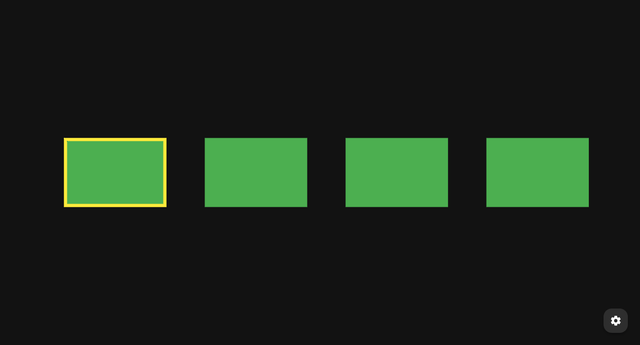
  NCL com navegação de foco e seleção ([focus_nav.ncl](https://ginga.org.br/gingaf/playground/?app=focus_nav.ncl))

---

<!-- _class: grid-2x2 center -->

# Pilar 1: gingaf

## NCLua, HTML+CCWS, HTML Embutido e Multiusuário

- 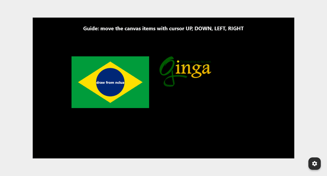
  NCL com desenho em tela Lua e teclas ([lua_canvas.ncl](https://ginga.org.br/gingaf/playground/?app=lua_canvas.ncl))

- 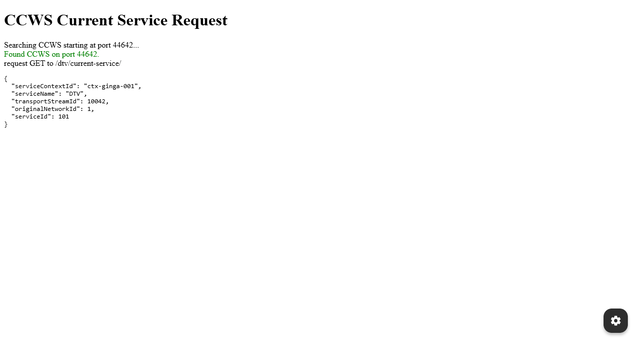
  HTML com CCWS /current-service/ ([current_service.html](https://ginga.org.br/gingaf/playground/?app=current_service.html))

- 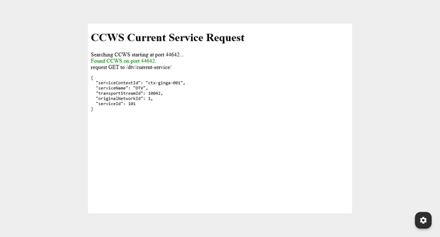
  NCL com documento HTML embutido ([emb_html.ncl](https://ginga.org.br/gingaf/playground/?app=emb_html.ncl))

- 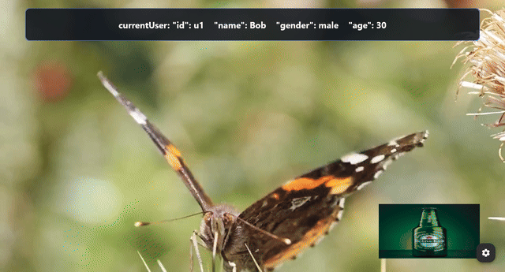
  NCL com troca de perfil multiusuário ([multiuser_profile/main.ncl](https://ginga.org.br/gingaf/playground/?app=multiuser_profile/main.ncl))

---

<!-- _class: invert -->
<!-- _paginate: skip -->

# Pilar 2: Portal Web ginga.org.br

---

<!-- _class: cols-2 vcenter -->

# Pilar 2: Portal Web ginga.org.br

- **Arquitetura Moderna**
  Construído com gerador de sites estáticos moderno (Zensical) e documentação multilíngue: português, espanhol e inglês.

  **Recursos Hospedados**
  Guias introdutórios para novos desenvolvedores Ginga, manual abrangente de tags e atributos do NCL, especificações oficiais do SBTVD e da ITU-T, e exemplos selecionados com trechos interativos de código.

- 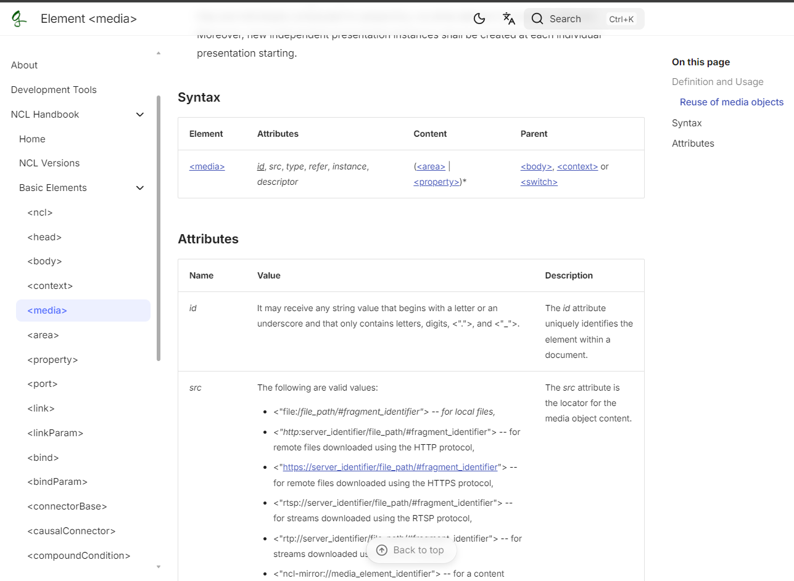

---

<!-- _class: invert -->
<!-- _paginate: skip -->

# Pilar 3: Ambiente Interativo ginga-playground

---

<!-- _class: cols-2 vcenter -->

# Pilar 3: Ambiente Interativo ginga-playground

- **Execução Web Sem Instalação**
  Executa diretamente em qualquer navegador moderno usando WebAssembly / CanvasKit, impulsionado pelo motor desacoplado `gingaf`.

  **Capacidades Interativas**
  Layout dividido (editor de código à esquerda e pré-visualização ao vivo da TV à direita), catálogo interativo pré-carregado com aplicações em NCL, Lua e HTML5, renderização instantânea sem recarregar a página e controle remoto virtual.

- 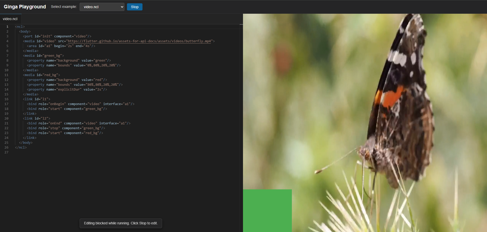

---

<!-- _class: invert -->
<!-- _paginate: skip -->

# Pilar 4: Extensão para VS Code ginga-code

---

<!-- _class: cols-2 vcenter -->

# Pilar 4: Extensão para VS Code ginga-code

- **Disponibilidade Oficial no Marketplace**
  https://marketplace.visualstudio.com/items?itemName=ginga-org-br.ginga-code
  Execução com um clique para pré-visualizar aplicações localmente ou no navegador.

  **Fluxos de Trabalho Modernos**
  Depuração conectando breakpoints da IDE aos estados de execução do `gingaf`.

- 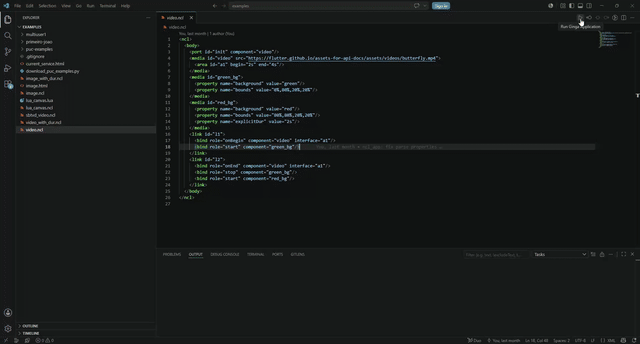

---

<!-- _class: invert -->
<!-- _paginate: skip -->

# Considerações Finais

---

# Considerações Finais

**Contribuições Principais**:
- **Portal `ginga.org.br`**: Hub unificado de documentação e especificações para a comunidade Ginga.
- **`ginga-playground`**: Workbench web interativo no navegador para prototipação sem instalação local.
- **`ginga-code`**: Extensão para VS Code que integra launcher e execução direta no desktop.

**Impacto**: Elimina o atrito inicial de configuração e viabiliza acesso imediato a estudantes, pesquisadores e desenvolvedores (código aberto em `https://ginga.org.br`).

---

<!--
_paginate: false
_header: ""
_class: cols-2 vcenter
-->

# Obrigado!

- ### Dúvidas e Discussão

  **Portal**: https://ginga.org.br

  **Playground**: https://ginga.org.br/gingaf/playground/

  **Extensão VS Code**: https://marketplace.visualstudio.com/items?itemName=ginga-org-br.ginga-code

  **Repositório**: https://github.com/ginga-org-br

  **Contato**: `a.guedes@reading.ac.uk` | `danielmoraes@telemidia.puc-rio.br`

- 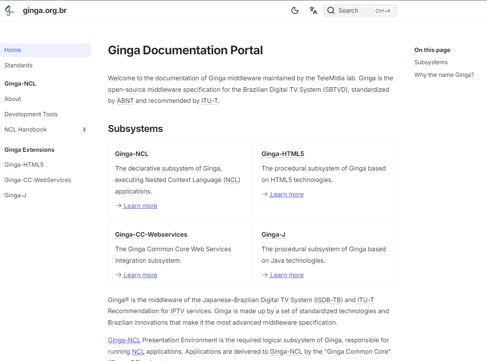
